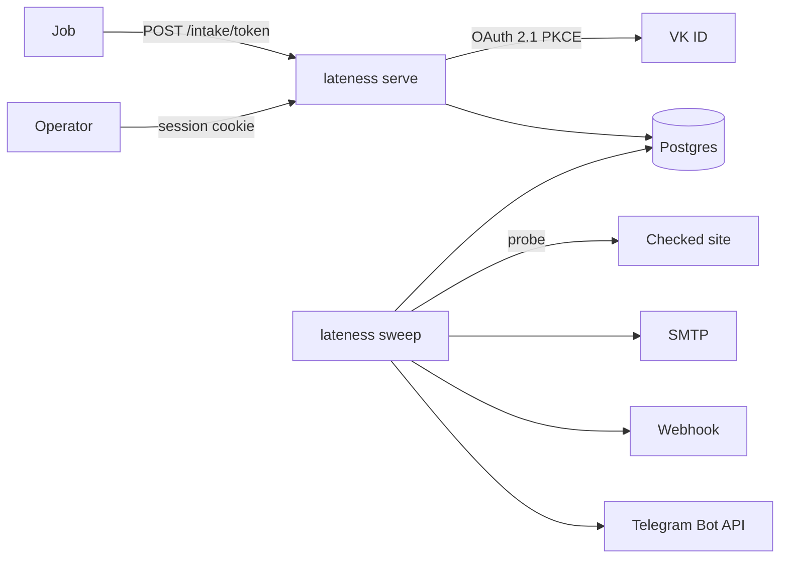

# Обзор системы

Два процесса одного бинарника:

- `lateness serve` принимает HTTP: страницы оператора, вход (пароль и VK ID), приём сигнала `POST /intake/{token}`, `/healthz` и `/readyz`. При старте применяет миграции. Это единственный владелец схемы.
- `lateness sweep` в цикле выполняет due-probes, закрывает просроченные окна и доставляет уведомления. Схему не меняет: на старте ждёт, пока `serve` её создаст, и выходит при несовпадении версии.

Служебные команды: `lateness invite` печатает ссылку-приглашение, `lateness receiver` — фейк webhook, Telegram и проверяемого сайта для e2e.

## Слои

| Слой | Каталог | Что делает |
|---|---|---|
| Домен | `backend/internal/domain` | Состояния, исходы, переходы, проверка outlet и probe, разбор тела приёма. Без ввода-вывода. |
| Расписание | `backend/internal/schedule` | Следующий запуск и дедлайн интервала и cron. Часы передаются снаружи. |
| Сценарии | `backend/internal/app` | Аккаунты, приглашения, проекты, ожидания, сигналы, probes, outlets, sweep. Решают; I/O — через интерфейсы `Store`, `Notifier`, `Prober`, `AuthProvider`. |
| Веб | `backend/internal/web` | Маршруты, страницы, intake, health. Тонкий слой над `app`. |
| Postgres | `backend/internal/adapters/postgres` | SQL, транзакции, шифрование настроек outlets. |
| Доставка | `backend/internal/adapters/delivery` | SMTP (без TLS, STARTTLS, TLS сразу), webhook, Telegram. |
| Probe | `backend/internal/adapters/probe` | HTTP(S)-запрос с таймаутом и защитой от SSRF. |
| Провайдеры входа | `backend/internal/adapters/authprovider` | VK ID; сюда же ляжет OIDC. |
| Секреты | `backend/internal/secret` | Случайные токены, хеши, AES-GCM. |

SQL не выходит из адаптера Postgres.

## Данные

Аккаунт владеет проектами. Вход — паролем или через провайдера (`identities`). Новый аккаунт создаётся только по одноразовому приглашению (`invites`), и вместе с ним — первый проект.

Проект содержит ожидания и outlets. У ожидания — источник (`intake` с токеном или `probe` с запросом), расписание, набор outlets, якорь окна, дедлайн, опционально дедлайн прогона после `begin` и время следующей проверки `probe_at`. Сигнал — журнал. Transition — смена состояния. Delivery — исходящее уведомление на переход, по строке на outlet.

Проекты, ожидания и outlets не удаляются: `deleted_at` их скрывает. Удаление проекта в одной транзакции помечает его ожидания и outlets, поэтому каждый запрос проверяет `deleted_at` только своей таблицы.

Ожидание пишется с оптимистичной блокировкой по `version`: параллельное изменение (правка оператора, результат probe, сигнал) получает `ErrConflict` вместо потери записи. Приём сигнала повторяет попытку до трёх раз.

## Проход sweep

1. Probes: `ClaimProbes` выбирает due-строки `FOR UPDATE SKIP LOCKED`, сдвигает `probe_at` на аренду, затем запросы выполняются параллельно (до 8) и результаты пишутся как сигналы.
2. `CloseDue` закрывает окна и прогоны, пишет transition и deliveries.
3. `ClaimDeliveries` забирает `pending`, outlet получает уведомление, строка помечается `sent`, снова `pending` или `failed`.
